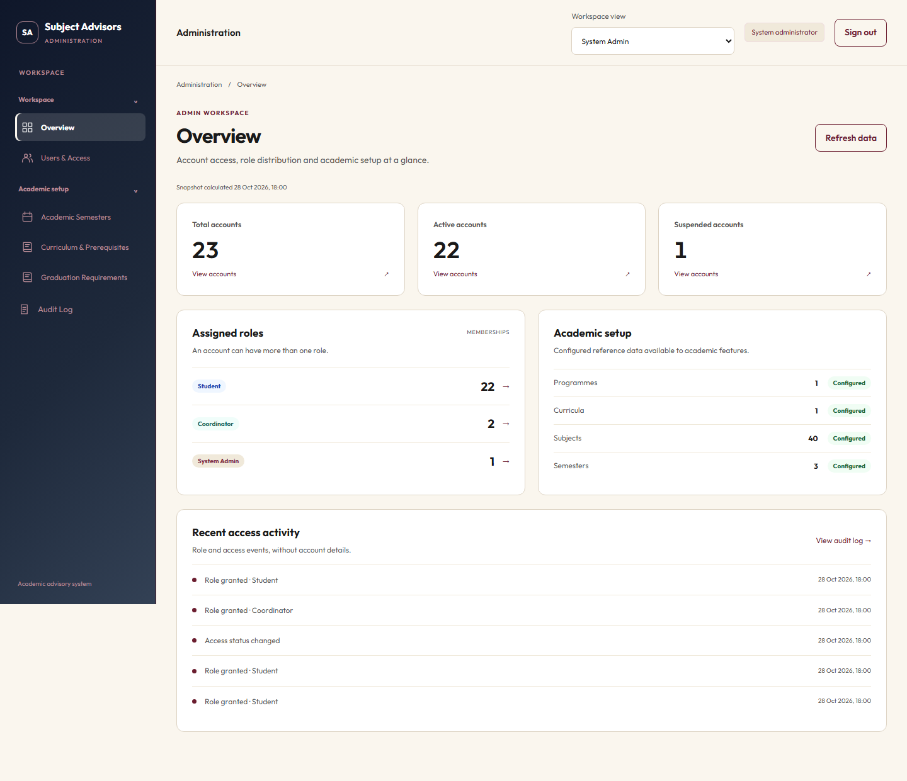
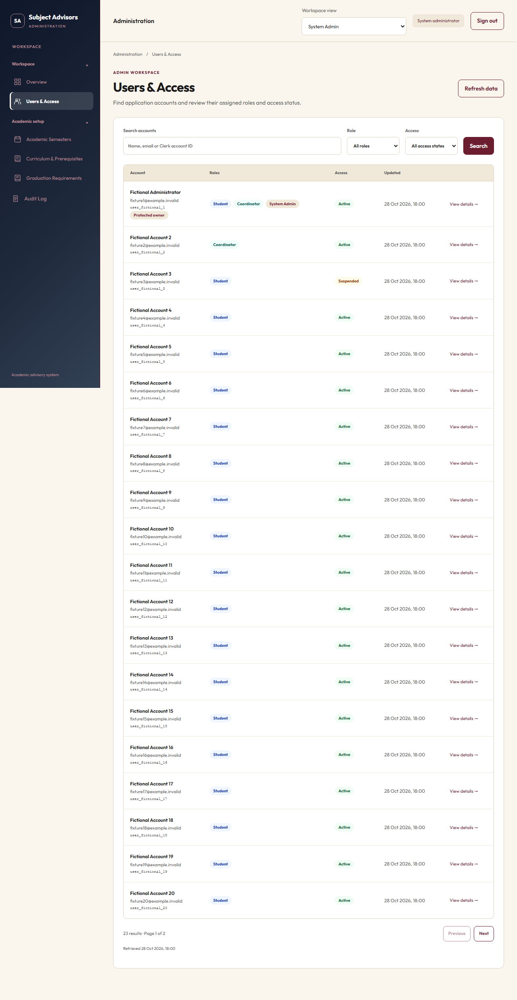
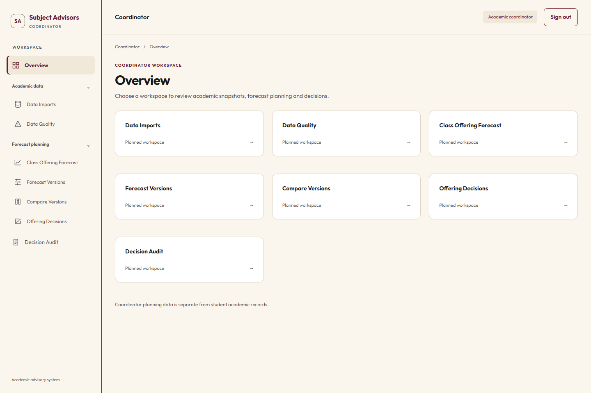
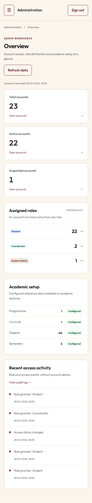

# P004 Work Outcome — Presenter Guide

**Presenter:** Mohd Sharhan
**Date:** 1 November 2026
**Project:** AI-Powered Academic Advisory System for UTMSPACE Part-Time Students

## Opening

> I delivered the Sprint 1 authentication foundation for students: account registration, sign-in and sign-out, plus server-side checks before protected access. The current integrated application also shows explicitly assigned staff workspaces. An authorized follow-on added read-only administration screens and a coordinator navigation skeleton. I’ll show what works today, where each role is stopped or handed off, and which parts remain planned.

## Outcome at a glance

| Area | Outcome | Scope/status |
|---|---|---|
| UC01 — Registration | Clerk sign-up UI at `/sign-up`; a verified `@graduate.utm.my` primary email is required for student application access. This is an application access rule, not a restriction on which domains Clerk can register. | P004 Sprint 1 core |
| UC02 — Login, logout and access | `/sign-in`, `/auth/complete`, session-aware account state, sign-out and guarded routes. The backend checks current explicit role membership and account status on protected requests. | P004 Sprint 1 core |
| Account association | After the backend verifies the student email, initialization idempotently creates the Clerk-ID association with STUDENT/ACTIVE. A duplicate initialization preserves existing roles and status, so it neither escalates roles nor reactivates a suspended account. | P004 Sprint 1 core |
| Account continuity | The small account snapshot is reused within the same login session to avoid repeating `/api/me` on each navigation. Protected APIs still authorize requests. The account check has a 15-second bound with Retry and Sign out recovery. | P004 follow-on |
| Multiple workspaces | Eligible assigned roles can be selected in the workspace switcher. It changes navigation only; it does not grant roles or replace server authorization. | Authorized follow-on |
| System administration | Overview, Users & Access, account details and Audit Log are read-only, protected screens. | Authorized M7 extension; not original Sprint 1 assignment |
| Coordinator area | Overview and a shared responsive navigation shell are present. Coordinator feature destinations are guarded skeleton pages without forecast/import/decision workflows. | Authorized M6 navigation extension |
| Academic product screens | Student profile/records, reported subject offerings and pathway are other owners’ work and integration destinations: P001, P002 and P003 respectively. | Not P004 deliverables |
| UC20 | Coordinator academic data and class-offering forecast workflow has a plan; the visible pages do not implement it. | Sprint 2 planned; [UC20 plan](sprint/02/p004/uc20-plan.md) |

## Related screens

| Route | Purpose | What to demonstrate | Status |
|---|---|---|---|
| `/sign-up` | Student account registration | Show the Clerk sign-up entry and verified student-email requirement. | P004 UC01 |
| `/sign-in` | Login for students and approved staff | Show the sign-in entry. A real sign-in requires the configured Clerk environment and an assigned account. | P004 UC02 |
| `/auth/complete` | Resolve account access after authentication | Explain that the app fetches account state and routes to the account’s allowed landing page. | P004 UC02 |
| `/student/setup` | First-time student profile handoff | Explain that setup is a P001 integration destination; incomplete setup is not treated as completed P004 profile work. | Integrated route; profile setup depends on P001 |
| `/admin` | Administrative overview | Show aggregate overview and navigation. | Read-only M7 extension |
| `/admin/users` | Search/filter accounts and access | Demonstrate search and filters; select an account to open its details. | Read-only M7 extension |
| `/admin/users/:id` | Account details and access history | Show account roles and recorded access history without changing them. | Read-only M7 extension |
| `/admin/audit` | Audit log | Show audit entries and explain that this UI exposes no mutation controls. | Read-only M7 extension |
| `/coordinator` | Coordinator overview | Show guarded overview and workspace navigation. | Navigation skeleton |
| `/coordinator/imports`, `/coordinator/data-quality`, `/coordinator/forecasts`, `/coordinator/versions`, `/coordinator/comparison`, `/coordinator/decisions`, `/coordinator/audit` | Future coordinator workflows | Open one planned destination and point out its “planned” state; no import, forecast or decision operation is implemented here. | Skeleton pages; UC20 remains planned |
| `/admin/semesters`, `/admin/curriculum`, `/admin/requirements` | Future admin academic setup | If time permits, show one planned destination and its unavailable/planned state. | Planned admin pages |

## Screenshot gallery

These are **reused existing review captures**, copied unchanged into this document’s gallery. They show fictional fixtures with mocked Clerk/API services and fictional identities/counts. They are not live-service screenshots or a live acceptance claim.

### Admin overview — desktop

**Talking point:** “The overview summarizes application account data. It does not expose account identity details on the overview, and it is a read-only review screen.”

### Users & Access — desktop

**Talking point:** “An authorized admin can search and inspect assigned access and account history. The screen provides no grant, suspension or other account mutation action.”

### Coordinator overview — desktop

**Talking point:** “This confirms the coordinator entry and responsive navigation structure. The overview and destinations do not yet perform academic imports or generate forecasts.”

### Admin overview — mobile

**Talking point:** “On a narrow screen, the overview cards stack vertically and the menu button provides access to staff navigation. The same role guard still applies.”

## Suggested 5–7 minute demonstration

1. **0:00–0:45 — Registration and sign-in:** Open `/sign-up`, point to the verified student email requirement, then show `/sign-in`.
2. **0:45–1:30 — Account handoff:** Explain `/auth/complete` and the first-time `/student/setup` handoff. Profile and records belong to P001; the route is not evidence that P004 delivered profile setup.
3. **1:30–2:15 — Access denial:** With an available safe demo session, attempt a staff route using an account without that assigned role. Show that access is denied. Explain that verified email establishes eligibility under policy, while explicit membership grants the role.
4. **2:15–2:45 — Workspace switch (if granted):** For an account already assigned multiple roles, switch views. Explain that the selector rechecks account roles and navigates only among assigned workspaces; the server remains authoritative. Skip this live step if no multi-role demo account is supplied.
5. **2:45–4:30 — Admin screens:** With an explicitly assigned SYSTEM_ADMIN demo account, show `/admin`, search on `/admin/users`, one `/admin/users/:id` detail page and `/admin/audit`. Point out that lookup/history is read-only and there are no account mutation controls.
6. **4:30–5:15 — Coordinator and mobile:** Show `/coordinator` and one planned workflow route. Use the mobile capture to explain responsive navigation. State clearly that forecasting/import/decision logic remains planned.
7. **5:15–6:00 — Logout and close:** Sign out and show return to the landing page. Recap that P004 supplied the auth/access foundation; P001–P003 own their academic destinations; UC20 is planned for Sprint 2.

For a live protected-screen walkthrough, use a configured demo environment with preassigned staff memberships; otherwise use the fictional captures.

## Verification and evidence

The statements above are based on the current route and auth sources and the associated change records:

- [Application route table](../apps/web/src/app/AppRoutes.tsx) and [auth flow/guards](../apps/web/src/features/auth/Auth.tsx)
- [Role switcher](../apps/web/src/features/auth/RoleSwitcher.tsx) and [role policy overview](auth-multi-role.md)
- [Multi-role access record](changes/S1-P004-012-multi-role-access.md)
- [Read-only admin record](changes/S1-P004-013-admin-read-only-workspace.md)
- [Staff navigation record](changes/S1-P004-016-staff-navigation-skeletons.md)
- [P004 Sprint 1 auth records](changes/S1-P004-001-server-auth-access.md) and [registration/login UI record](changes/S1-P004-002-clerk-auth-ui.md), plus [session account caching](changes/S1-P004-010-session-account-cache.md) and [bounded access check](changes/S1-P004-011-bounded-account-check.md)
- [P001 profile/records records](changes/S1-P001-001-profile-and-records.md), [P002 offering record](changes/S1-P002-005-root-overlay.md), and [P003 pathway handoff](p003-sprint1-handoff.md)

Historical verification recorded in [S1-P004-016](changes/S1-P004-016-staff-navigation-skeletons.md):

| Historical check | Recorded result | Context |
|---|---|---|
| Unit suite | 400 passed; 13 skipped in two existing suites | Credential-dependent suites were skipped. |
| Admin browser suite | 24 passed | Mocked Clerk/API and fictional fixtures. |
| Integration browser suite | 34 passed | Mocked Clerk/API and fictional fixtures. |
| Typecheck, lint, local build and Cloudflare dry-run | Passed | Recorded at the time; dry-run only, no deployment. |
These results are historical and were not rerun for this presentation. The captures above show fictional fixtures; they are not production data or evidence of live role provisioning, live API acceptance or deployment. No fresh application tests were run and no deployment occurred for this documentation-only change.

## Limits and next steps

- UC01/UC02 authentication and server access controls are the original P004 Sprint 1 outcome; multi-role support, the M7 read-only screens and M6 navigation skeleton were later authorized extensions.
- Admin screens depend on an already assigned active SYSTEM_ADMIN role and available configured services. No role was granted for this presentation.
- Coordinator routes are navigation skeletons. UC20 workflow behavior remains planned in Sprint 2.
- Student profile/records (P001), subject offerings (P002) and academic pathway (P003) are integration destinations owned by those workstreams.

## Presenter close

> P004 established how users sign in and how protected access is checked. The additional staff screens show a guarded direction for administration and coordination, while clearly leaving academic workflows to their assigned owners and the planned Sprint 2 work.
